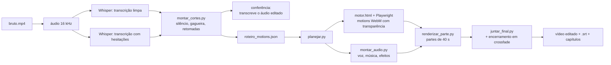

# Editor de vídeo longo por código 🎬

Uma skill para o Claude que edita vídeos longos do YouTube **do bruto ao MP4 final**, sem abrir editor de vídeo.

Você grava a tela e fala. O Claude:
- transcreve o vídeo duas vezes com o Whisper (uma limpa e outra que pega cada gagueira);
- corta **todo** silêncio, gagueira, falso começo e frase recomeçada, sempre ficando a última versão;
- confere os cortes transcrevendo de novo o áudio já editado;
- cria **motions animados** por código (HTML + Playwright) na identidade visual do seu canal;
- gera **ícones e objetos 3D** no ChatGPT e usa junto com os motions;
- desfoca o que não pode aparecer na tela;
- mixa a voz a -14 LUFS com música de fundo baixinha e ducking;
- fecha com o seu encerramento em crossfade;
- entrega o vídeo, a legenda `.srt`, os capítulos e a descrição pronta para o YouTube.

Você só aprova duas prévias (os primeiros 60 s e os últimos 30 s).

## Resultado real
O vídeo "Jailbreak no Claude Sonnet 5.5" do canal [Vitor Menoli](https://www.youtube.com/@vitor.menoli) foi editado inteiro com esta skill:

| | |
|---|---|
| Bruto | 21,0 min |
| Editado | 8,9 min (+ encerramento) |
| Cortes | 73, sendo 22 retomadas e falsos começos |
| Motions | 56 (capítulos, painéis, etiquetas, transições) |
| Desfoques | prompt do jailbreak e palavrões escritos na tela |
| Áudio | -14,0 LUFS integrado |

## Como funciona


O "editor" é o Claude seguindo o `SKILL.md`: ele lê as transcrições, decide o que cortar, escolhe onde entram os motions (sempre ancorados em frases da fala), confere tudo e só então renderiza.

## Instalação
Requisitos: Python 3.10+, FFmpeg 4.4+ (com libx264 e libvpx-vp9), Node 18+ e uns 8 GB de RAM livre para o Whisper large-v3.

```bash
git clone <este repositório> editor-video-longo
cd editor-video-longo
pip install -r requirements.txt
npm install
npx playwright install chromium
```

Coloque os arquivos do seu canal em `midia/` (música de fundo, encerramento e logo; veja `midia/LEIA.md`).

### Usar como skill
- **Claude Code:** copie a pasta para `~/.claude/skills/editor-video-longo/` (ou `.claude/skills/` dentro do projeto) e peça: "edita o vídeo `bruto.mp4` usando o roteiro `roteiro.md`".
- **App do Claude:** compacte a pasta em `.zip` e envie na área de Skills das configurações.

## Personalizando para o seu canal
- **Estilo:** troque `referencias/folha_de_estilo_exemplo.md` pela folha de estilo do seu canal (duração, quando entra motion, volume da música, cores, o que nunca fazer).
- **Visual dos motions:** as cores ficam nas variáveis CSS do começo do `motions/motor.html`, e a marca d'água na constante `MARCA_DAGUA`.
- **Sons:** `python3 motions/sons.py motions/sons` gera de novo os efeitos (pop, sopro, contador, digitação, impacto), sintetizados e sem direitos autorais.
- **Novos modelos de motion:** cada modelo é uma função `modelos.<nome>` no `motor.html` que monta o HTML e devolve `desenhar(tempo)`. Referência dos modelos que já existem em `referencias/modelos_de_motion.md`.

## Estrutura
| Pasta | Conteúdo |
|---|---|
| `SKILL.md` | O passo a passo completo que o Claude segue |
| `scripts/` | Pipeline em Python: transcrição, cortes, conferência, planejamento, áudio, render, legenda |
| `motions/` | Motor de motions (`motor.html`), renderizador Playwright, captura de prints, sons e fontes |
| `modelos/` | Exemplos reais de `decisoes.json` e `roteiro_motions.json` |
| `referencias/` | Folha de estilo de exemplo, referência dos motions, imagens geradas, ambiente remoto |
| `midia/` | Seus arquivos de música, encerramento e logo (fora do Git) |

## Princípios
- **Nunca inventa fala.** Edição é cortar e decorar o que foi gravado: nada de frase nova nem voz sintética.
- **Números reais.** Resultado de teste vai com o número da tela e a fonte.
- **Logos de outras marcas só por print real** do site oficial, nunca redesenhados nem gerados.
- **Você aprova antes do final.**

## Créditos
Criado por [Vitor Menoli](https://vitormenoli.com) com o Claude, a partir da edição dos vídeos do canal.
Fontes Inter, JetBrains Mono e Space Grotesk sob a SIL Open Font License 1.1 (veja `motions/fontes/LICENCAS.md`).
