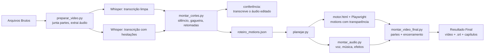

# Claude Video Editor 🎬

Uma skill para o Claude que edita vídeos longos do YouTube **do bruto ao MP4 final**, sem abrir editor de vídeo.

Você grava a tela e fala, coloca o bruto e o roteiro numa pasta e pede "edita o vídeo". O Claude:
- transcreve o vídeo duas vezes com o Whisper (uma limpa e outra que pega cada gagueira);
- corta **todo** silêncio, gagueira, falso começo e frase recomeçada, sempre ficando a última versão;
- corta as esperas (instalação, programa carregando, IA respondendo);
- confere os cortes transcrevendo de novo o áudio já editado;
- cria **motions animados** por código (título, capítulos, painéis, etiquetas, números, comparações) quando a tela fica parada;
- desfoca o que não pode aparecer na tela;
- mixa a voz com música de fundo baixinha e fecha com o seu encerramento (os dois opcionais);
- entrega o vídeo, a legenda `.srt`, os capítulos e a descrição pronta para o YouTube.

## Instalação
Peça ao Claude Code:

> Instala essa skill pra mim: https://github.com/vitormenoli/claude-video-editor

Ou instale na mão:
```bash
git clone https://github.com/vitormenoli/claude-video-editor ~/.claude/skills/claude-video-editor
```
(no Windows: `%USERPROFILE%\.claude\skills\claude-video-editor`)

Na primeira vez, o Claude:
1. **pede a pasta** que vai ser usada para as edições;
2. **instala tudo sozinho** (pacotes Python, Playwright, modelo do Whisper) e, se faltar algo do sistema (Python, FFmpeg ou Node.js), diz exatamente o que falta e como instalar;
3. **pergunta como você quer editar:** duração mínima e máxima, se quer prévias antes do final, música de fundo, encerramento, cores e marca d'água dos motions, efeitos sonoros, qualidade da transcrição;
4. **cria a estrutura** da pasta com as suas configurações.

Requisitos do sistema: Python 3.10+, FFmpeg 4.4+ (com libx264 e libvpx-vp9), Node.js 18+ e ~8 GB de RAM livre para o Whisper `large-v3` (os modelos `medium` e `small` usam menos).

## Como usar
Depois de configurada, a pasta fica assim:
```
Sua pasta/
  Arquivos Brutos/     ← coloque aqui o vídeo bruto e o roteiro (.md ou .txt)
  Midia do Canal/      ← música de fundo, encerramento e logo (opcionais)
  Resultado Final/     ← o vídeo editado sai aqui
  _edicao/             arquivos de trabalho
  config_editor.json   suas configurações
  folha_de_estilo.md   suas regras de edição (edite à vontade)
```
- **Um vídeo só** em `Arquivos Brutos`, ou várias partes com os nomes **`Parte 1.mp4`, `Parte 2.mp4`...** (juntadas nessa ordem).
- **Roteiro** com título, descrição, os blocos na ordem (viram os capítulos), links citados e o que não pode aparecer na tela.
- Peça: **"edita o vídeo"**.

Se você ativou as prévias, o Claude manda primeiro os 60 s do começo e os 30 s do fim para você aprovar (em `Resultado Final/Previas`). Depois sai o vídeo completo em `Resultado Final`.

## Como funciona


O "editor" é o Claude seguindo o `SKILL.md`: ele lê as transcrições, decide o que cortar, escolhe onde entram os motions (sempre ancorados em frases da fala), confere tudo e só então renderiza.

## Personalizando
- **Regras de edição:** `folha_de_estilo.md` na sua pasta (começa com um modelo).
- **Números:** `config_editor.json` (duração, prévias, volumes, silêncio mínimo, música, encerramento). Para mudar depois, é só pedir ao Claude.
- **Visual dos motions:** cor de destaque, cor de fundo e marca d'água no `config_editor.json` (`motions`). Para mudanças maiores, os modelos estão em `motions/motor.html` (cada modelo é uma função `modelos.<nome>`). Referência em `referencias/modelos_de_motion.md`.
- **Sons:** `python motions/sons.py motions/sons` gera de novo os efeitos (pop, sopro, contador, digitação, impacto), sintetizados e sem direitos autorais.

## Estrutura do repositório
| Pasta | Conteúdo |
|---|---|
| `SKILL.md` | O passo a passo completo que o Claude segue |
| `scripts/` | Instalação, configuração da pasta, preparação, transcrição, cortes, conferência, planejamento, áudio, render, legenda |
| `motions/` | Motor de motions (`motor.html`), renderizador Playwright, captura de prints, sons e fontes |
| `modelos/` | Exemplos de `decisoes.json` e `roteiro_motions.json` |
| `referencias/` | Modelo de folha de estilo, referência dos motions e o modo com computador remoto |

## Princípios
- **Nunca inventa fala.** Edição é cortar e decorar o que foi gravado: nada de frase nova nem voz sintética.
- **Não mexe nos seus arquivos.** Tudo de trabalho fica em `_edicao`.
- **Números reais.** Resultado de teste vai com o número da tela e a fonte.
- **Logos de outras marcas só por print real** do site oficial.

## Créditos
Criado por [Vitor Menoli](https://www.youtube.com/@vitor.menoli) com o Claude.
Fontes Inter e JetBrains Mono sob a SIL Open Font License 1.1 (veja `motions/fontes/LICENCAS.md`).
